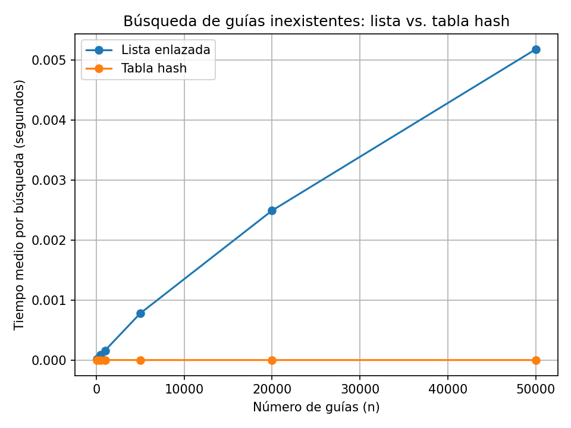
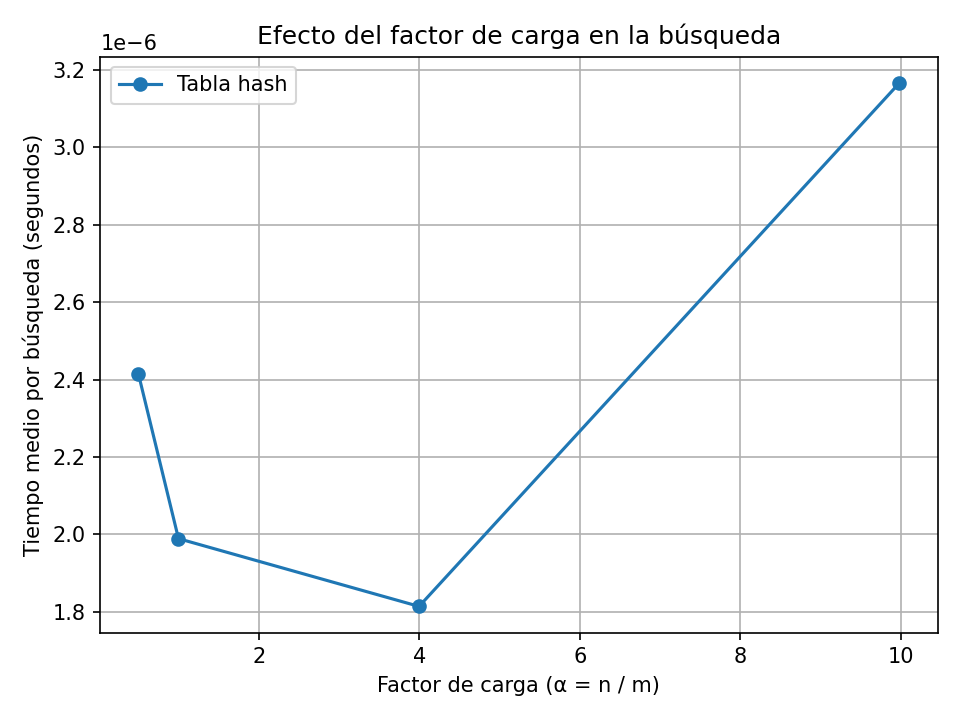

# Laboratorio 3 — Estructuras de datos

**Nombre:** Kevin Alejandro Grajales Camacho

## Parte 1 — Implementar y verificar

Código: [estructuras.py](./estructuras.py) y [pruebas.py](./pruebas.py).

Las pruebas verifican búsqueda exitosa e infructuosa, las colisiones de las guías 10, 24 y 17 con m=7, la longitud de la cadena en la casilla 3, el factor de carga 3/7 y la coincidencia de las estructuras en 20 conjuntos aleatorios.

## Parte 2 — Medir y graficar

Código: [medicion.py](./medicion.py).

Se cronometra solamente el ciclo de búsquedas usando `time.perf_counter()`. Para cada tamaño se realizan 200 consultas de guías inexistentes y se promedian tres rondas. Las estructuras se construyen antes de iniciar el cronómetro. La generación de guías usa semillas fijas.

### Experimento A: lista frente a tabla

La gráfica compara el tiempo medio por búsqueda para los tamaños seleccionados. La tabla usa una cantidad de casillas prima cercana a n/2, para que el factor de carga se mantenga cercano a 2.

### Experimento B: efecto del factor de carga

Se mantiene n=20.000 y se usan tablas con cuatro factores de carga objetivo: 0,5; 1; 4 y 10. El valor real puede diferir ligeramente porque m se ajusta a un número primo.

## Parte 3 — Análisis

**Escribe las cinco respuestas con tus propias palabras y usando los datos reales de las gráficas.** La guía pide un máximo total de 900 palabras. No dejes esta sección como una descripción genérica: agrega los factores de crecimiento observados, las cifras de tus mediciones y la recomendación para operaciones.

### 1. Costo teórico
- Explica el recorrido completo de la lista cuando la guía no existe.
- Explica el papel de α y el supuesto de distribución uniforme de la función hash.
- Indica qué sucede si todas las claves terminan en una sola casilla.

### 2. Lo medido contra lo esperado
- Elige dos tamaños consecutivos de la primera gráfica y calcula los factores de crecimiento de ambas estructuras.
- Compara con Θ(n) para la lista y el comportamiento promedio Θ(1) de la tabla cuando α se mantiene aproximadamente constante.
- Describe la tendencia de la segunda gráfica al aumentar α.

### 3. Explique las colisiones
- Define colisión y usa 10, 24 y 17 con m=7 como ejemplo.
- Explica encadenamiento y direccionamiento abierto, con una ventaja y un costo de cada método.

### 4. Tabla hash o árbol de búsqueda
- Explica por qué la tabla hash no es adecuada para consultas por rango.
- Compara un árbol binario degenerado (altura aproximada 400.000 y hasta unas 400.000 comparaciones en la búsqueda) con un árbol equilibrado (altura de orden log₂ n, alrededor de 19 para 400.000 nodos).

### 5. Concepto para operaciones
- Recomienda una tabla hash para consultas puntuales y un árbol equilibrado para rangos.
- Estima el tiempo de búsqueda de una guía inexistente con 5.000.000 de guías a partir de las mediciones. Explica la forma de crecimiento utilizada y deja claro que es una estimación.
