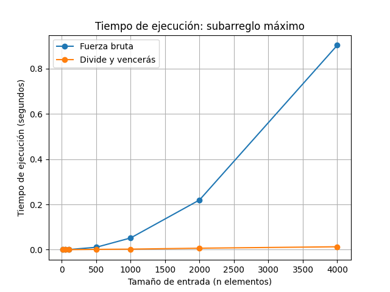

# Laboratorio 2: Divide y vencerás

Kevin Alejandro Grajales Camacho


## Estructura del proyecto

- [`subarreglo.py`](./subarreglo.py): implementa los algoritmos de fuerza bruta, divide y vencerás y la suma cruzada.
- [`pruebas.py`](./pruebas.py): contiene pruebas de casos conocidos y listas aleatorias.
- [`medicion.py`](./medicion.py): mide los tiempos de ejecución y genera la gráfica.
- [`graficas/tiempo_vs_n.png`](./graficas/tiempo_vs_n.png): gráfica comparativa de los tiempos medidos.

## Cómo ejecutar el laboratorio

Se necesita Python 3 y la biblioteca Matplotlib.

Desde la carpeta `lab2-divide-y-vencer`, ejecutar las pruebas:

```powershell
python pruebas.py
```

Para medir los tiempos y generar la gráfica:

```powershell
python medicion.py
```

El programa comprueba que ambos algoritmos obtengan la misma suma máxima para cada tamaño de entrada. Si las sumas no coinciden, se produce un error de aserción.

## Parte 1: Implementación y pruebas

Se implementaron dos soluciones para encontrar el subarreglo contiguo con la mayor suma.

- **Fuerza bruta:** recorre los posibles puntos de inicio y acumula las sumas de los subarreglos.
- **Divide y vencerás:** divide la lista en dos partes, resuelve cada mitad de forma recursiva y compara los resultados con el mejor subarreglo que cruza el punto medio.

La función `suma_cruzada` calcula el mejor subarreglo que contiene elementos de ambos lados del punto medio.

Las pruebas incluyen la serie de ejemplo, una lista con un solo elemento, una lista con todos sus elementos negativos, una lista con todos sus elementos positivos, un caso que cruza el punto medio y 20 listas aleatorias.

En la serie `[-3, 5, -2, 8, -6, 3, 9, -4]`, ambos algoritmos encuentran una suma máxima de **17**.

## Parte 2: Medición de tiempos

Se utilizó `time.perf_counter()` para medir los tiempos de ejecución. Se generaron listas de números enteros entre -100 y 100, con una semilla fija para facilitar la reproducción de los resultados.

Se evaluaron siete tamaños de entrada: 10, 50, 100, 500, 1000, 2000 y 4000 elementos. Para cada tamaño, se verificó que ambos algoritmos obtuvieran la misma suma máxima.

### Gráfica comparativa

La gráfica muestra los tiempos de ejecución de ambos algoritmos. Para entradas pequeñas, la diferencia puede ser mínima y la recursividad puede añadir cierta sobrecarga. A medida que aumenta el tamaño de entrada, divide y vencerás presenta una ventaja más clara.



## Parte 3: Análisis de complejidad

### 1. Recurrencia y teorema maestro

En el algoritmo de divide y vencerás, el problema se divide en dos subproblemas de tamaño aproximado `n/2`. Además, se calcula el mejor subarreglo que cruza el punto medio recorriendo los elementos de ambos lados, lo que requiere tiempo lineal.

Por lo tanto, la recurrencia es:

`T(n) = 2T(n/2) + Θ(n)`

En el teorema maestro, se tiene `a = 2`, `b = 2` y `f(n) = Θ(n)`. Como `n^(log₂ 2) = n`, se cumple el caso 2 del teorema maestro y la complejidad es:

`T(n) = Θ(n log n)`

El algoritmo de fuerza bruta, al acumular la suma de cada subarreglo sin recalcularla desde cero, tiene complejidad `Θ(n²)`.

### 2. Comportamiento empírico

En las mediciones realizadas, el tiempo de fuerza bruta crece de forma más rápida que el de divide y vencerás. Al duplicar la entrada de 1000 a 2000 elementos, el tiempo de fuerza bruta se multiplicó aproximadamente por 4,24, mientras que el de divide y vencerás lo hizo por 2,77. Al pasar de 2000 a 4000 elementos, los factores fueron aproximadamente 4,11 y 1,99, respectivamente.

Estos resultados son compatibles con las complejidades teóricas de ambos algoritmos, aunque los tiempos pueden variar entre ejecuciones.

### 3. Punto de cruce

Con 10 elementos, fuerza bruta fue más rápida en esta medición. Desde 50 elementos, divide y vencerás obtuvo menores tiempos para todos los tamaños evaluados. Por tanto, el punto de cruce observado se encuentra entre 10 y 50 elementos, aunque sería necesario medir tamaños intermedios para estimarlo con mayor precisión.